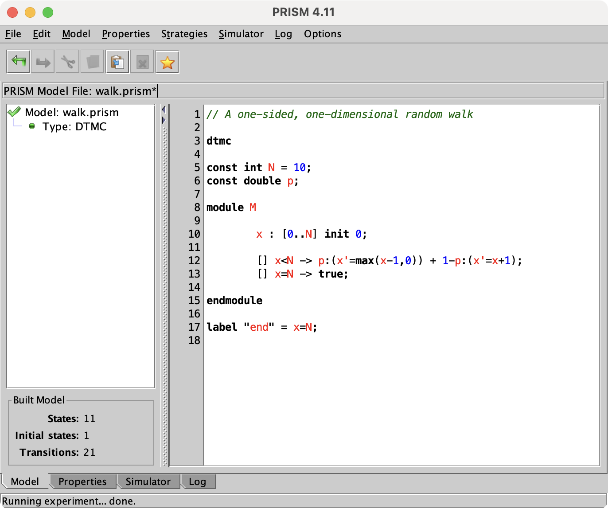
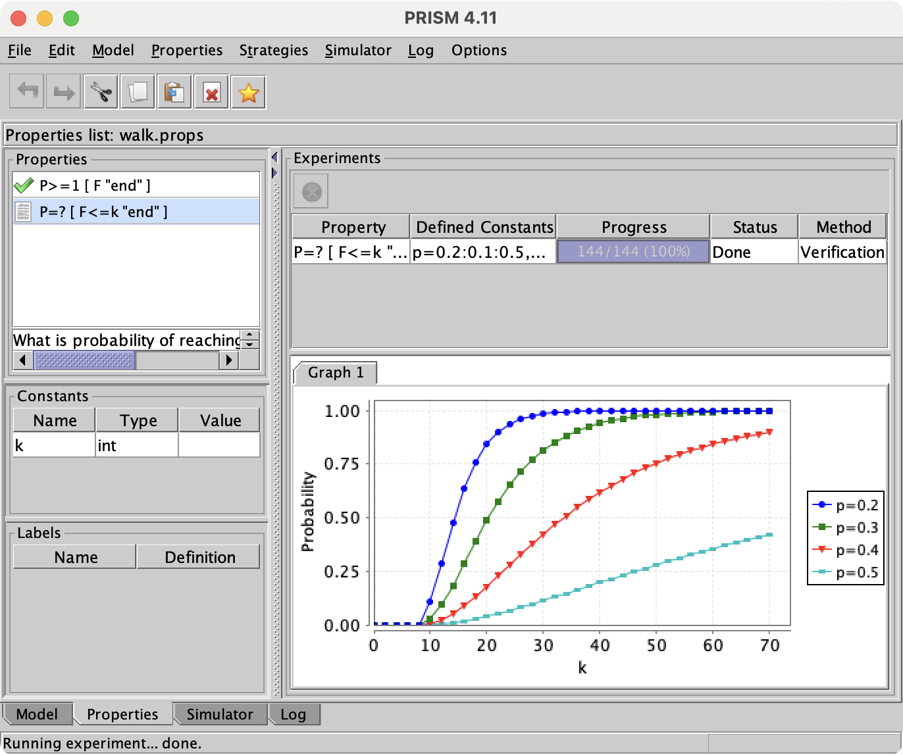

# First steps

To get started with PRISM, check that you can run either the
graphical user interface (`xprism`) or the command-line version (`prism`),
as explained in the [installation instructions](Installing.md).

<a id="starting-prism"></a>
In short, to run the PRISM GUI:

- (on Windows) click the short-cut (to `xprism.bat`) installed on the Desktop/Start Menu
- (on other OSs) run the `xprism` script in the `bin` directory

and for the command-line:

- run the `prism` script in the `bin` directory

You first need a model. Here is a small random walk,
specified in the [PRISM modelling language](../ThePRISMLanguage/README.md):

[walk.prism](../files/walk.prism "include")

Loading it into the GUI (`xprism walk.prism`) lets us view and edit the model:



Some examples of [properties](../PropertySpecification/README.md) to be checked are:

[walk.props](../files/walk.props "include")

Also loading this properties file into the GUI (e.g., `xprism walk.prism walk.props`),
we can verify the first property to be true and,
with a small change to the constant `p` and an [experiment](../RunningPRISM/Experiments.md),
we can start visualising results of the model's analysis:



All this and more can be done from the command line.
Just giving the model file builds it and displays some statistics:

```shell
prism walk.prism

# ...
# Type:        DTMC
# States:      11 (1 initial)
# Transitions: 21
# ...
```

or we can verify a property:

```shell
prism walk.prism walk.props -prop 1

# ...
# Result: true
```

Full details of both the GUI and command-line versions of PRISM
are given in the "[Running PRISM](../RunningPRISM/README.md)" section of this manual.
For more detailed walkthroughs of the tool, try the [PRISM tutorial](https://www.prismmodelchecker.org/tutorial/).
