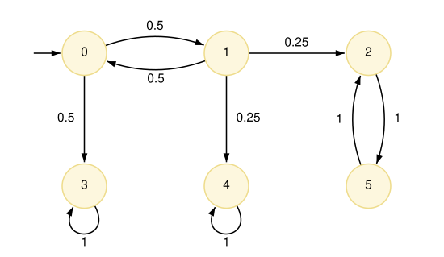
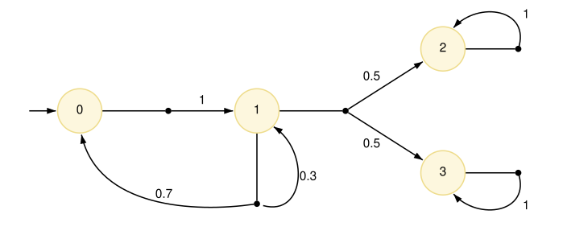
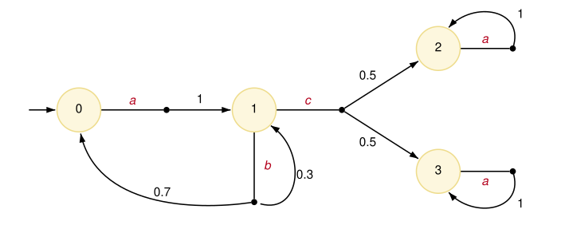
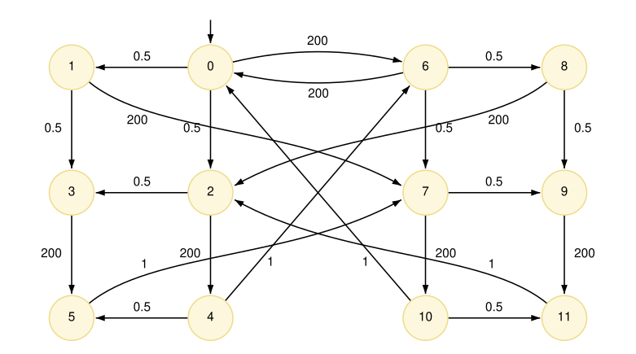

# Explicit model files

This appendix details the plain text file formats used by PRISM for [exporting](../RunningPRISM/ImportingAndExportingModels.md#exporting) and [importing](../RunningPRISM/ImportingAndExportingModels.md#importing) models that have already been constructed, i.e., they comprise an explicit list of states, transitions, etc. making up the model, rather than a high-level model description in the [PRISM modelling language](../ThePRISMLanguage/README.md).
Below, we describe:

- [PRISM explicit (.pexp) files](#pexp)
- [Transitions (.tra) files](#tra)
- [Transitions (.tra) files (row form)](#trarows)
- [Labels (.lab) files](#lab)
- [State rewards (.srew) files](#srew)
- [Transition rewards (.trew) files](#trew)
- [State (.sta) files](#sta)

The examples are exported from four small PRISM models, which are shown, with diagrams, in the last section, [Source PRISM files](#source).

---

<a id="pexp"></a>
## PRISM explicit (.pexp) files

The default now for exporting models in textual format from PRISM
is to do so in a combined .pexp file, that includes all parts of the model,
as described individually in more detail below.

Here is an example, for the (DTMC) PRISM model [lec3.prism](#lec3):

```text
# Transitions (DTMC)
6 9
0 1 0.5
0 3 0.5
1 0 0.5
1 2 0.25
1 4 0.25
2 5 1
3 3 1
4 4 1
5 2 1

# States
(s)
0:(0)
1:(1)
2:(2)
3:(3)
4:(4)
5:(5)

# Labels
0="init" 1="deadlock"
0: 0

# Reward structure "r"
# State rewards
6 3
0 2
4 1
5 1

# Reward structure "r"
# Transition rewards
6 4
1 0 1
1 2 1
1 4 1
2 5 2
```

See below for the format of the constituent parts.

---

<a id="tra"></a>
## Transitions (.tra) files

These contain an explicit list of the transitions making up a probabilistic model, i.e. they are essentially a sparse matrix representation of the transition probability/rate matrix. After an (optional) header line containing the word `Transitions` and the model type, the first line of the file contains information about the size of the model, then the remaining lines contain information about transitions, one per line.

**DTMCs and CTMCs**

For Markov chains the initial line takes the form "`n m`", giving the number of states (`n`) and the number of transitions (`m`). The remaining lines are of the form "`i j x`" or "`i j x a`", where `i` and `j` are the indices of the source state (row) and destination state (column) of the transition, and `x` is the probability (for a DTMC) or rate (for a CTMC) of the transition. State indices are zero-indexed (i.e. between `0` and `n-1`). Probability/rate values are written as (positive) floating point numbers (examples: `0.5`, `.5`, `5.6e-6`, `1`). `a` is optional and gives the action label for the transition. Action labels can be present for some, all or no transitions.

It is assumed that source states (rows) are in ascending order, but there is no assumption about the ordering of destination states (columns) within the transitions for each source state.

For a DTMC, the probabilities for the outgoing transitions of each state should sum to 1.

Here is an example, for the (DTMC) PRISM model [lec3.prism](#lec3):

```text
# Transitions (DTMC)
6 9
0 1 0.5
0 3 0.5
1 0 0.5
1 2 0.25
1 4 0.25
2 5 1
3 3 1
4 4 1
5 2 1
```

and here is one for the (CTMC) PRISM model [poll2.prism](#poll2):

```text
# Transitions (CTMC)
12 22
0 1 0.5
0 2 0.5
0 6 200 loop1a
1 3 0.5
1 7 200 loop1a
2 3 0.5
2 4 200 loop1b
3 5 200 loop1b
4 5 0.5
4 6 1 serve1
5 7 1 serve1
6 7 0.5
6 8 0.5
6 0 200 loop2a
7 9 0.5
7 10 200 loop2b
8 9 0.5
8 2 200 loop2a
9 11 200 loop2b
10 11 0.5
10 0 1 serve2
11 2 1 serve2
```

**MDPs (or PAs)**

For MDPs, the format is an extension of the above
To clarify terminology: each *state* of the MDP contains (nondeterministic) *choices*, each of which is essentially a probability distribution over successor states that we can view as a set of *transitions*. Optionally, each choice can be labelled with an *action*.

The first (non-header) line of the file take the form "`n c m`", giving the number of states (`n`), the total number of choices (`c`) and the total number of transitions (`m`). The remaining lines are of the form "`i k j x`" or "`i k j x a`", where `i` and `j` are the indices of the source state (row) and destination state (column) of the transition, `k` is the index of the choice that it belongs to, and `x` is the probability of the transition. `a` is optional and gives the action label for the choice of the transition. Action labels can be present for some, all or no states but, in slightly redundant fashion, the action labels, if present, must be the same for all transitions belonging to the same choice.

State indices and choice indices are all zero-indexed. Probability values (as above) are written as (positive) floating point numbers and should sum to 1 for each choice.
It is assumed that source states (rows) and choices within states are in ascending order, but there is no assumption about the ordering of destination states (columns) within the transitions for each choice.

Here is an example, for the (MDP) PRISM model [lec12mdp.prism](#lec12mdp):

```text
# Transitions (MDP)
4 5 7
0 0 1 1
1 0 0 0.7
1 0 1 0.3
1 1 2 0.5
1 1 3 0.5
2 0 2 1
3 0 3 1
```

and here is an action-labelled version of the same model, [lec12mdpa.prism](#lec12mdpa):

```text
# Transitions (MDP)
4 5 7
0 0 1 1 a
1 0 2 0.5 c
1 0 3 0.5 c
1 1 0 0.7 b
1 1 1 0.3 b
2 0 2 1 a
3 0 3 1 a
```

**POMDPs**

The format of a `.tra` file for a POMDP is similar to an MDP,
but also contains information about observations.

The initial line of the file takes the form "`n c m o`", where `n`, `c` and `m` are, as for MDPs, the numbers of states, choices and transitions,
and `o` is the number of observations.
The lines that list transitions contain an additional integer after the transition probability
(and before the action, if present), giving the (deterministic) observation that is made
when entering the target state of that transition.
Currently, it is assumed that these are consistent for all states.

In order to also specify the observation for the initial state,
a dummy transition line of the form `- - s - o` is used,
giving both the initial state `s` and its observation `o`.

An example file is:

```text
# Transitions (POMDP)
10 16 18 4
- - 0 - 0
0 0 1 0.1 1 toss
0 0 2 0.3 1 toss
0 0 3 0.6 1 toss
1 0 4 1 2 guess1
1 1 7 1 3 guess2
1 2 7 1 3 guess3
2 0 8 1 3 guess1
2 1 5 1 2 guess2
2 2 8 1 3 guess3
3 0 9 1 3 guess1
3 1 9 1 3 guess2
3 2 6 1 2 guess3
4 0 4 1 2 loop
5 0 5 1 2 loop
6 0 6 1 2 loop
7 0 7 1 3
8 0 8 1 3
9 0 9 1 3
```

---

<a id="trarows"></a>
## Transitions (.tra) files (row form)

There is an alternative format for transition matrices (see the [rows](../RunningPRISM/ImportingAndExportingModels.md#other) option for `-exportmodel`) where transitions for each state/choice are collated on a single line.

Here is the result for the [lec3.prism](#lec3) example from above (a DTMC):

```text
# Transitions (DTMC)
6 9
0 0.5:1 0.5:3
1 0.5:0 0.25:2 0.25:4
2 1:5
3 1:3
4 1:4
5 1:2
```

for the [lec12mdp.prism](#lec12mdp) example (an MDP):

```text
# Transitions (MDP)
4 5 7
0 1:1
1 0.7:0 0.3:1
1 0.5:2 0.5:3
2 1:2
3 1:3
```

and for the [lec12mdpa.prism](#lec12mdpa) example (an MDP with actions):

```text
# Transitions (MDP)
4 5 7
0 1:1 a
1 0.5:2 0.5:3 c
1 0.7:0 0.3:1 b
2 1:2 a
3 1:3 a
```

---

<a id="lab"></a>
## Labels (.lab) files

These contain an explicit list of which [labels](../ThePRISMLanguage/ConstantsLabelsAndFormulas.md#labels) are satisfied in each state.
After a header, showing `Labels`,
the first line lists the labels, assigning each one an index.
The remaining lines list indices of all states satisfying one or more labels,
followed by a list of the indices of labels that are satisfied in it.
This includes the built-in labels `"init"` (initial states) and `deadlock` (deadlock states).
An example is shown below, for [lec12mdp.prism](#lec12mdp), where, for example, both `"heads"` and `"end"` are satisfied in state 2.

```text
# Labels
0="init" 1="deadlock" 2="heads" 3="tails" 4="end"
0: 0
2: 2 4
3: 3 4
```

---

<a id="srew"></a>
## State rewards (.srew) files

For reward files, the header, gives the name of the reward structure that generated it
and the type of rewards (state or transitions) stored in the file.
For state rewards, the information following this header is an explicit list of the (non-zero) state rewards.
The first line is of the form `n m` where `n` is the number of states in the model and `m` is the number of non-zero state rewards.
The following `m` lines are of the form `i r`, denoting that the state reward for state `i` is `r`.

For the [lec3.prism](#lec3) (6-state) DTMC example from above, we get rewards in 3 states (0, 4 and 5):

```text
# Reward structure "r"
# State rewards
6 3
0 2
4 1
5 1
```

---

<a id="trew"></a>
## Transition rewards (.trew) files

Files containing transition rewards, like those for state rewards, start with a header.
The rest of the file is formatted identically to transitions files (see [above](#tra)),
except that probabilities/rates are replaced with reward values,
and the number of transitions (the last number on the first line) is replaced with the number of non-zero transition rewards.

For the [lec3.prism](#lec3) (6-state) DTMC example from above, we get non-zero transition rewards on 4 transitions:

```text
# Reward structure "r"
# Transition rewards
6 4
1 0 1
1 2 1
1 4 1
2 5 2
```

And for the [lec12mdpa.prism](#lec12mdpa) (4-state) MDP example, we get non-zero transition rewards on 4 transitions:

```text
# Reward structure "r"
# Transition rewards
4 5 4
1 0 2 6
1 0 3 6
1 1 0 5
1 1 1 5
```

---

<a id="sta"></a>
## States (.sta) files

These contain an explicit list of the reachable states of a model. The first (non-header) line is of the form `(v1,...,vn)`, listing the names of all the variables in the model in the order that they appear in the PRISM model. Subsequent lines list the values of the `n` variables in each state of the model. Each line is of the form `i:(x1,...,xn)`, where `i` is the index of the state (starting from 0) and `x1,...,xn` are the values of each variable in the state. States are ordered by their index (and, therefore, given PRISM's default behaviour, lexicographically according to the tuple of variable values).

For the example PRISM model [poll2.prism](#poll2), the states file looks like:

```text
# States
(s,a,s1,s2)
0:(1,0,0,0)
1:(1,0,0,1)
2:(1,0,1,0)
3:(1,0,1,1)
4:(1,1,1,0)
5:(1,1,1,1)
6:(2,0,0,0)
7:(2,0,0,1)
8:(2,0,1,0)
9:(2,0,1,1)
10:(2,1,0,1)
11:(2,1,1,1)
```

---

<a id="source"></a>
## Source PRISM files

The examples above were exported by PRISM from the following models.
Each is shown with a diagram of the resulting model, in which states are labelled with their indices, as used in the files above.

<a id="lec3"></a>
### lec3.prism

A DTMC with 6 states and a reward structure `"r"`:

[lec3.prism](../files/lec3.prism "include")



<a id="lec12mdp"></a>
### lec12mdp.prism

An MDP with 4 states and 5 choices, and labels `"heads"`, `"tails"` and `"end"`:

[lec12mdp.prism](../files/lec12mdp.prism "include")



<a id="lec12mdpa"></a>
### lec12mdpa.prism

The same MDP, with actions on its choices, and a reward structure `"r"` on actions `b` and `c`:

[lec12mdpa.prism](../files/lec12mdpa.prism "include")



<a id="poll2"></a>
### poll2.prism

A CTMC with 12 states: a polling system with two stations (the same as `poll2.sm` in the `prism-examples` directory).
The values of its variables in each state are listed in the [states file](#sta) above:
states 0 to 5 have the server at station 1 (`s=1`), on the left, and states 6 to 11 at station 2, on the right.

[poll2.prism](../files/poll2.prism "include")


