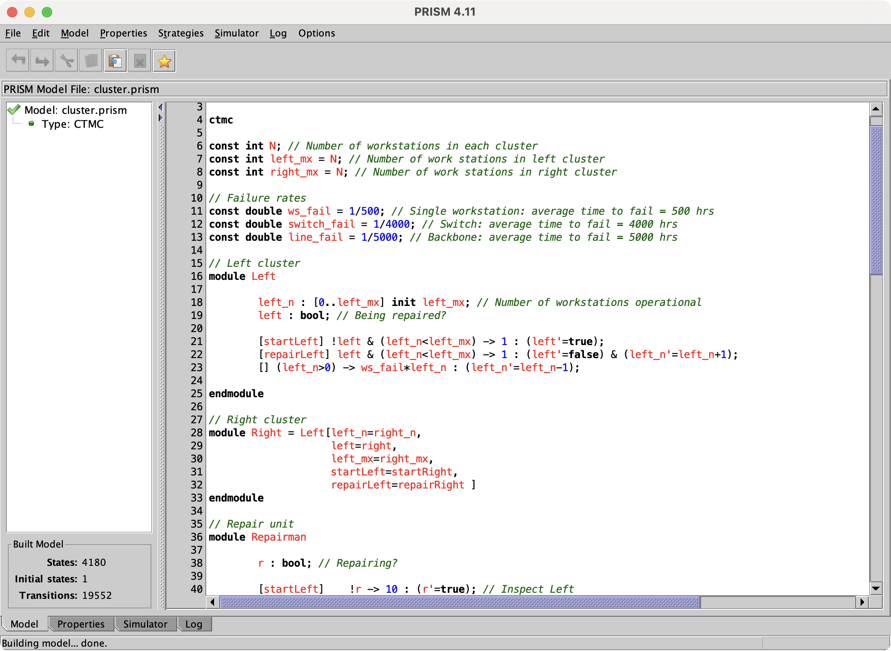

# Loading and building a model

Typically, when using PRISM, the first step is to load a model that has been specified in the PRISM modelling language.
If using the GUI, select menu option "Model | Open Model" and choose a file.
There is a selection of sample PRISM model files in the `prism-examples` directory of the distribution.
A few very small models are contained in the subdirectory `simple`;
the rest are in subdirectories grouped by model type.

The model will then be displayed in the editor in the "Model" tab of the GUI window.
The file is parsed upon loading. If there are no errors, a green tick will be visible.
If there are errors in the file, a red cross will appear instead and the errors will be highlighted in the model editor.
To view details of the error, position the mouse pointer over the source of the error (or over the red cross).
Alternatively, select menu option "Model | Parse Model" and the error message will be displayed in a message box.
Models can be edited or written from scratch in the GUI's editor.



## Building the model

In order to perform model checking, PRISM will (in most cases) need to construct the corresponding probabilistic model,
i.e., convert the PRISM model description to, for example, an MDP, DTMC, etc.
During this process, PRISM computes the set of states in the model which are reachable from the initial states and the transition matrix which represents the model.

Model construction is done automatically when you perform [model checking](ModelChecking.md). However, you may also want to explicitly ask PRISM to build the model in order to test for errors or to see how large the model is. From the GUI, you can do this by selecting "Model | Build Model". If there are no errors during model construction, the number of states and transitions in the model will be displayed in the bottom left corner of the window.

From the command-line, simply type:

```shell
prism model.prism
```

where `model.prism` is the name of the file containing the model description.

For some types of models, notably PTAs, models are not constructed in this way (because the models are infinite-state). In these cases, analysis of the model is not performed until model checking is performed.

<a id="deadlocks"></a>
## Deadlocks

You should be aware of the possibility of **deadlock** states in the model,
i.e., states which are reachable but from which there are no outgoing transitions.
PRISM will automatically search your model for deadlocks and, by default,
"fix" them by adding self-loops in these states.
Since deadlocks are sometimes caused by modelling errors,
PRISM will display a warning message in the log when deadlocks are fixed in this way.

You can control whether deadlocks are automatically fixed in this way using the "Automatically fix deadlocks" option (or with command-line switches `-nofixdl` and `-fixdl`). When fixing is disabled, PRISM will report an error when the model contains deadlocks.

If you have unwanted or unexpected deadlocks in your model, there are several ways you can detect them. Firstly, by disabling deadlock fixing (as described above), PRISM will display a list of deadlock states in the log. Alternatively, you can model check the [filter](../PropertySpecification/Filters.md) property `filter(print, "deadlock")`, which has the same effect.

To find out *how* deadlocks occur, i.e., which paths through the model lead to a deadlock state, there are several possibilities.
Firstly, you can model check the [CTL](../PropertySpecification/Non-probabilisticProperties.md) property `E[F "deadlock"]`.
When checked from the GUI, this will provide you with the option of displaying a path to a deadlock in the simulator.
From the command-line, a path to a deadlock will be displayed in the log, for example with:

```shell
prism model.prism -pf 'E[F "deadlock"]'
```

Finally, in the eventuality that the model is too large to be model checked, you can still use the [simulator](Simulation.md) to search for deadlocks. This can be done either by manually generating random paths using the [simulator in the GUI](Simulation.md#gui) or, [from the command-line](Simulation.md#cl), e.g. by running:

```shell
prism dice.prism -simpath deadlock stdout
```
