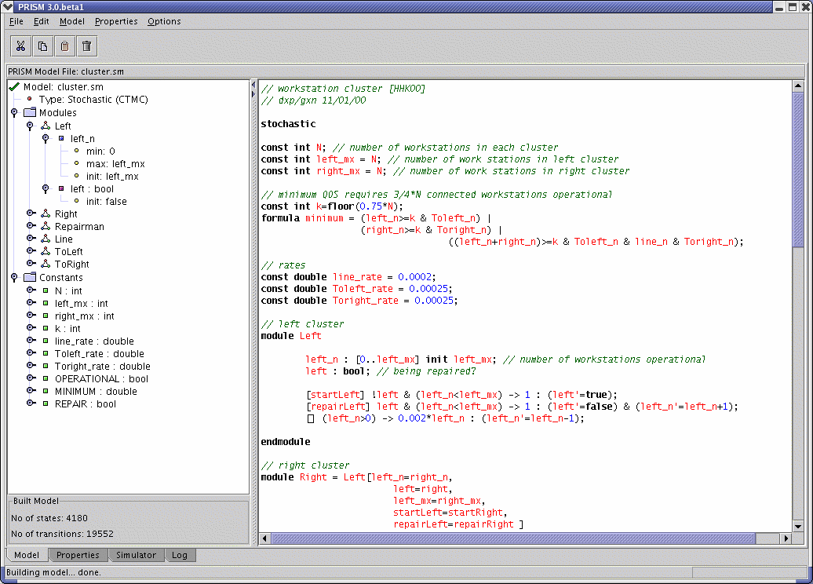
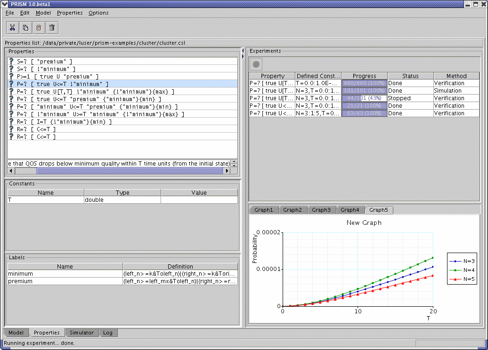

# Starting PRISM

There are two versions of PRISM, one based on a graphical user interface (GUI),
the other based on a command line interface. Both use the same underlying model checker.
The latter is useful for running large batches of jobs, leaving long-running model checking tasks in the background, or simply for running the tool quickly and easily once you are familiar with its operation.

Details how how to run PRISM can be found in the [installation instructions](../InstallingPRISM/Instructions.md).
In short, to run the PRISM GUI:

- (on Windows) click the short-cut (to `xprism.bat`) installed on the Desktop/Start Menu
- (on other OSs) run the `xprism` script in the `bin` directory

You can also optionally specify a model file and a properties file to load upon starting the GUI, e.g.:

```shell
xprism example.prism
xprism example.prism example.props
```

To use the command-line version of PRISM, run the `prism` script, also in the `bin` directory, e.g.:

```shell
prism example.prism example.props -prop 2
```

The `-dir` switch can be used to specify a directory for input (and output) files.
So the following are equivalent:

```shell
prism ~/myfiles/example.prism ~/myfiles/example.props
prism -dir ~/myfiles example.prism example.props
```

The remainder of this section of the manual describes the main types of functionality offered by PRISM.
For a more introductory guide to using the tool, try the
[tutorial](https://www.prismmodelchecker.org/tutorial/) on the PRISM web site.
Some screenshots of the GUI version of PRISM are shown below.


*The PRISM GUI (editing a model)*


*The PRISM GUI (model checking)*
