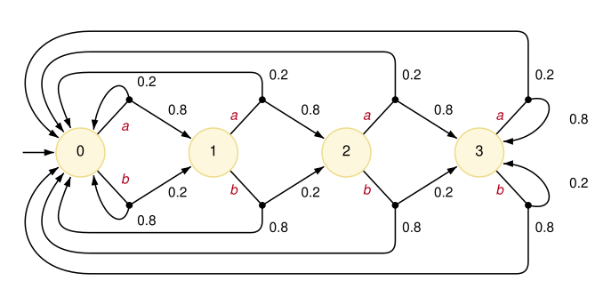

# Actions and nondeterminism

The examples presented so far have been DTMCs, which means that each state has
one or more outgoing transitions with associated probabilities that sum to one.
Another core model type supported by PRISM is the **Markov decision process** (MDP),
which allows for **nondeterminism** in the model.
In this case, each state can have several **choices**,
each of which defines a probability distribution over successor states.
Often, but not always, these choices are labelled with **actions**.

In the PRISM language, nondeterminism is modelled by allowing the guards of its commands to overlap.
Each enabled command in a state defines a separate choice,
and its (optional) action label is specified using the square brackets at the start of the command.

<a id="example"></a>
## An example MDP

The following example represents a classic MDP, the "chain" model [[Str00](../Reference/References.md#Str00)].
There are `N` states in a chain, and in each one there are two possible actions:
`a`, which moves one step along the chain, and `b`, which goes back to the start.
But actions are not completely reliable:
with probability `slip`, the other action happens instead.

[chain.prism](../files/chain.prism "include")

The keyword `mdp` indicates that the model is an MDP.
The module has a single variable `s` representing the position in the chain,
which ranges from 0 to `N-1` using a [constant](ConstantsLabelsAndFormulas.md#constants) `N` (here, 4).

The two commands have the guard `true`, so both are enabled in every state.
In the resulting MDP, each state has two choices, labelled `a` and `b`.
For example, in state `s=0`, there are two choices:

- `a`: move to state `s=1` with probability 0.8, or stay in `s=0` with probability 0.2
- `b`: stay in `s=0` with probability 0.8, or move to state `s=1` with probability 0.2

The full MDP is shown below, where each state is labelled with its value of `s`.



<a id="actions"></a>
## Actions

The commands above are labelled with actions `a` and `b`, written between the square brackets, e.g.:

```prism
	[a] true -> 1-slip : (s'=min(s+1,N-1)) + slip : (s'=0);
```

For an MDP, these actions play several roles.
Firstly, they allow the definition of [policies](../RunningPRISM/Strategies.md),
specifying which action to take in each state
in order to satisfy or optimise some [property](../PropertySpecification/ThePOperator.md#nondeterminism).
Actions can also be used (for all model types, not just MDPs)
to define [rewards](CostsAndRewards.md) and
to enforce [synchronisation](CompositionAndSynchronisation.md#synchronisation) between commands in different modules.

However, actions are optional.
For an MDP, omitting them from a command (`[]`) results in unlabelled choices.
For example these commands:

```prism
[] x<5 -> (x'=x+1);
[] x>2 -> (x'=x-1);
```

result, in states `x=3` and `x=4`, in two unlabelled choices incrementing or decrementing `x`.

In similar fashion, PRISM allows the definition of MDPs in which the choices
from a state have the same action (technically, this is a probabilistic automaton, rather than an MDP):

```prism
[a] x<5 -> (x'=x+1);
[a] x>2 -> (x'=x-1);
[b] x=3 -> true;
```

In both cases (unlabelled choices and duplicate actions),
restrictions may be imposed on the generation of [policies](../RunningPRISM/Strategies.md).

<a id="local-nondeterminism"></a>
## Local nondeterminism

We refer to the nondeterminism arising from overlapping guards in a single module as **local nondeterminism**.
In MDPs comprising multiple modules, nondeterminism also arises due to the
[concurrent interleaving](CompositionAndSynchronisation.md#composition-mdps) of its commands' execution.

In models that do not include nondeterminism, overlapping guards are treated differently.
In particular, in a DTMC, if several commands are enabled in a state,
it is assumed that one of them is picked uniformly at random.
For example, given the following model:

```prism
dtmc

module M

    x : [0..3] init 0;
    
    [] x=0 -> 0.1:(x'=1) + 0.9:(x'=2);
    [] x=0 -> (x'=3);
    [] x>0 -> true;
    
endmodule
```

the first two overlapping commands result in state `x=0` of the DTMC
having three outgoing transitions, to states `x=1`, `x=2` and `x=3`,
with probabilities 0.05, 0.45 and 0.5, respectively.
