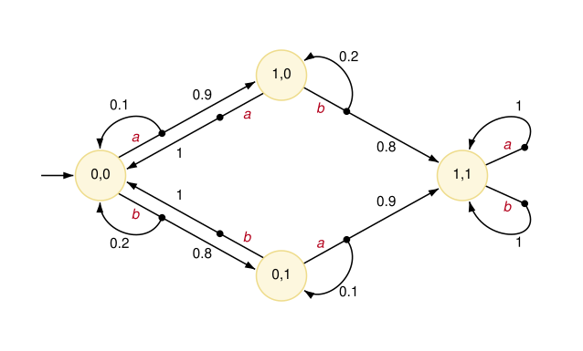
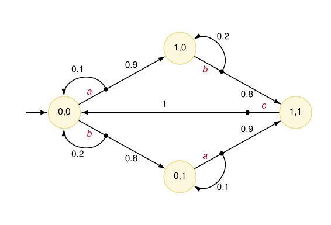
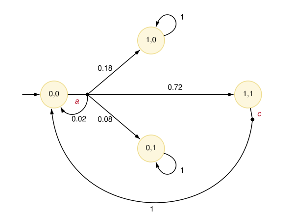
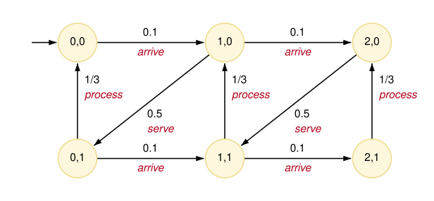

# Composition and synchronisation

Most PRISM models involve the **parallel composition** of several modules, which may interact with each other in various ways.
In such cases, the *global state* of the whole model comprises the *local states* of all modules,
i.e., the values of the local variables of each module.
Furthermore, a module can *read* the values of any other variable in the model
(for example, it can refer to it in the guards of its commands)
but a module can only *write* to its own local variables.

The manner in which modules are composed depends on the model type.
We start by describing the case for MDPs, which provide a natural model
for the parallel composition of probabilistic components,
use this to introduce some of the key ideas, notably **synchronisation**.
and then also describe how the composition of modules is handled for DTMCs and CTMCs.

<a id="composition-mdps"></a>
## Composing modules in MDPs

The example below illustrates the parallel composition of two modules in an MDP,
communicating with each other by reading each other's variables.

[parallel-mdp.prism](../files/parallel-mdp.prism "include")

Both modules start in local state `0` and randomly move to local state `1` with some probability.
When in state `1`, they simply copy the other module's state (e.g., `(s1'=s2)` in module `P1`),
and so return to state `0` if the other module is still in state `0`,
or remain in state `1` if the other module is in state `1`.
References to other modules' variables can also appear in guards,
but here are just used on the right-hand sides of updates.

The resulting MDP is shown below, and comprises global states of the form `(s1,s2)`.
Although it is not necessary, we labelled the commands of the two modules with actions, `a` and `b`,
which helps identify which module is responsible for each transition.
When both modules have an enabled command (all states in this example),
the choice between which one executes is nondeterministic.
So, even though neither module has overlapping guards,
all states of the MDP have a choice, between actions `a` and `b`.



The above example had no *local nondeterminism*.
If we changed the second module to the version shown below,
where its initial choice to move to state `1` or stay in state `0` is nondeterministic,
then states `(0,0)` and `(1,0)` in the MDP above would
have three nondeterministic choices, two labelled with `b` and one with `a`.

```prism
module P2
	s2 : [0..1] init 0;

	[b] s2=0 -> (s2'=1);
	[b] s2=0 -> (s2'=0);
	[b] s2=1 -> (s2'=s1);
endmodule
```

<a id="synchronisation"></a>
## Synchronisation

Modules can also use **synchronisation** to coordinate their behaviour.
In the above example, modules had distinct actions, `a` and `b`, which occurred independently.
Commands with the *same* action label, however, are required to synchronise:
both are executed simultaneously, and this only happens when both commands are enabled.

Below, we modify the second commands of the two modules in the previous example,
removing the references to the other module's variable and using a shared action `c`. 

[parallel-sync.prism](../files/parallel-sync.prism "include")

Now, when both modules are in state `1`, they synchronise on action `c` and move to state `(0,0)`.
And in state `(1,0)` or state `(0,1)`, where only one of the `c`-labelled commands is enabled,
the synchronisation cannot occur, so the enabled `c`-labelled command is blocked:



The actions over which two modules synchronise are those that appear in both modules;
any other actions are independent.

Synchronising commands can both have probabilistic updates.
In the variant below, the first commands of the two modules are both labelled with action `a`,
so they too have to synchronise:

[parallel-sync2.prism](../files/parallel-sync2.prism "include")

Now, in state `(0,0)`, the two modules move together, in a single choice labelled `a`,
whose probability distribution is the product of the distributions of the two commands.
For example, both modules move to state `1` with probability 0.9 * 0.8 = 0.72,
and only `P1` does so with probability 0.9 * 0.2 = 0.18.
In states `(1,0)` and `(0,1)`, however, neither `a` nor `c` can occur, since each needs both modules,
so these are [deadlock](ModulesAndCommands.md#commands) states, to which PRISM adds self-loops:



Synchronisation is often used as a simple way to model "sending" data from one module to another.
In the example below, module `P1` chooses randomly whether to set its local variable `s1` to `1` or `2`.
It then communicates the result of this to module `P2` by offering either action `c1` or `c2` for synchronisation,
depending on the value of `s1`. In isolation, module `P2` would exhibit local nondeterminism,
but in parallel with `P1` only ever performs `c1` or `c2` in a state.

[mdp-send.prism](../files/mdp-send.prism "include")

We can achieve the same behaviour in another way by simultaneously synchronising on a single
action `c` and module `P2` reading the value of `s1` as it updates its own variable `s2`:

[mdp-send2.prism](../files/mdp-send2.prism "include")

<a id="composition-ctmcs"></a>
## Composing modules in CTMCs

For a [CTMC](ContinuousTime.md),
parallel composition between modules works analogously to MDPs,
except that the choice between enabled commands is a race condition, not nondeterministic.
Consider two commands in different modules that are labelled with actions `a` and `b`,
where those actions are used only in those modules.
Then, in a state where both commands are enabled, each results in a separate outgoing transition, with its own rate.
For two commands with a common action `c` synchronisation occurs,
with both commands being executed simultaneously
and the rate of the synchronised transition taken as the product of the two individual rates.

This is illustrated by the model below,
in which jobs arrive into an `N`-place queue
and are removed by a server which processes them one at a time.

[queue.prism](../files/queue.prism "include")

The CTMC (assuming `N=2`, as above) is shown below, with the states labelled as `q,s`.



In a CTMC, the product of two rates does not always meaningfully represent the rate of a synchronised transition.
A common technique, as seen here, is to make one command *passive*, with rate `1`, and the other *active*,
which actually defines the rate for the synchronised transition
(in this case, `mu * 1 = mu`).

<a id="composition-dtmcs"></a>
## Composing modules in DTMCs

In a DTMC, the choice between two enabled commands with non-shared actions is probabilistic,
with each command being selected with equal probability.
It is much more common, in DTMC models that use multiple modules,
to make modules synchronise fully, leaving no situations where a choice between enabled commands is randomised.

Below is a simple example, borrowed from the model of
[Herman's self-stabilisation algorithm](https://www.prismmodelchecker.org/casestudies/self-stabilisation/#herman),
in which two modules repeatedly move in lockstep,
with a probabilistic update that depends on the other module's state.
(The second module is defined using [module renaming](#module-renaming), described below.)

[dtmc-sync.prism](../files/dtmc-sync.prism "include")

Both commands of each module are labelled with action `step`,
and in every state exactly one of them is enabled, so every transition of the DTMC
is a synchronisation of both modules.
When the two modules synchronise, the probability of the resulting transition is
the product of the probabilities of the two individual updates.
So, in states `(0,0)` and `(1,1)`, where `x1=x2`, both modules choose a new value at random,
giving four transitions, each with probability 0.5 * 0.5 = 0.25;
in states `(0,1)` and `(1,0)`, each module copies the other's value,
and the model moves to the other one of these two states with probability 1.

<a id="module-renaming"></a>
## Module renaming

PRISM also supports **module renaming**, which allows reuse of a module definition
when there are several modules with (almost) identical behaviour.
Below, we rewrite the `parallel-mdp.prism` example from above,
using module renaming to define `P2` in terms of `P1`:

[parallel-mdp-rename.prism](../files/parallel-mdp-rename.prism "include")

The syntax is as follows:

```prism
module Mnew = Mold [ old1=new1, old2=new2, ... ] endmodule
```

where the renames `old1=new1`, `old2=new2`, ... specify how identifiers appearing in
the original module `Mold` are to be renamed in the new module `Mnew`.
The renaming is done at a textual level, so variables, constants and actions can all be renamed in this way.
In the example, `s1` has to be renamed, in order to give `P2` a distinct variable `s2`,
but we also need to rename `s2`, since `P1` refers to it in its updates, and the action `a`.
Note also how we convert the literal probabilities (`0.9` and `0.8`) into constants,
which allows them to differ in the second module.

Take care when using module renaming in conjunction with [formulas](ConstantsLabelsAndFormulas.md#formulas).
Expansion of formulas is done *before* module renaming so,
if a module which uses formulas is renamed to another module,
it is the contents of the formula which will be renamed, not the formula itself.

<a id="global-variables"></a>
## Global variables

As seen in several of the examples above, variables within a module
are considered to be **local variables**, in that they can only be *written* by that module.
They can however be *read* by any module.
PRISM also allows *global variables*,
which can be written to, as well as read, by all modules.
Like local variables, these can be integers or Booleans.
Global variables are declared in identical fashion to a module's local variables,
except that the declaration must not be inside the definition of any module.
Some example declarations are as follows:

```prism
global g : [1..10];
global b : bool init true;
```

A global variable can be modified by any module and provides another way for modules to interact.
An important restriction on the use of global variables is the fact that commands which [synchronise](#synchronisation) with other modules
cannot modify global variables. PRISM will detect this and report an error.


<a id="process-algebra-operators"></a>
## Process algebra operators

To make the concept of synchronisation described above more powerful,
PRISM allows you to define precisely the way in which the set of modules are composed in parallel.
This is specified using the `system ... endsystem` construct,
placed at the end of the model description, which should contain a process-algebraic expression.
This expression should feature each module exactly once, and can use the following (CSP-based) operators:

- `M1 || M2` : alphabetised parallel composition of modules `M1` and `M2` (synchronising on only actions appearing in both `M1` and `M2`)

- `M1 ||| M2` : asynchronous parallel composition of `M1` and `M2` (fully interleaved, no synchronisation)

- `M1 |[a,b,...]| M2` : restricted parallel composition of modules `M1` and `M2` (synchronising only on actions from the set {`a`, `b`,...})

- `M / {a,b,...}` : hiding of actions {`a`, `b`, ...} in module `M`

- `M {a<-b,c<-d,...}` : renaming of actions `a` to `b`, `c` to `d`, etc. in module `M`.

The first two types of parallel composition (`||` and `|||`) are associative and can be applied to more than two modules at once.
When evaluating the expression, the hiding and renaming operators bind more tightly than the three parallel composition operators.
No other rules of precedence are defined and parentheses should be used to specify the order in which modules are composed.

Some examples of expressions which could be included in the `system ... endsystem` construct are as follows:

- `(station1 ||| station2 ||| station3) |[serve]| server`
- `((P1 |[a]| P2) / {a}) || Q`
- `((P1 |[a]| P2) {a<-b}) |[b]| Q`

When no parallel composition is specified by the user,
PRISM implicitly assumes an expression of the form `M1 || M2 || ...` containing all of the modules in the model.
For a more formal definition of the process algebra operators described above, check the semantics of the PRISM language, available from the "[Documentation](https://www.prismmodelchecker.org/doc/)" section of the PRISM website.

