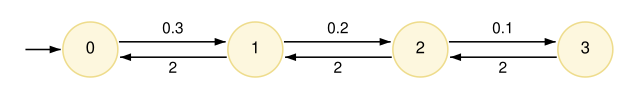

# Continuous time

The models seen so far, DTMCs and MDPs, are *discrete-time*:
they move from state to state in discrete time steps.
A **continuous-time Markov chain** (CTMC) instead permits real-valued time delays
between the occurrence of transitions.
More precisely, each transition of a CTMC has a **rate**, rather than a probability,
and the time taken for the transition to happen is a random delay,
which is *exponentially distributed* with that rate.
A transition with rate *r* takes, on average, time 1/*r*:
the higher the rate, the sooner the transition is likely to happen.
CTMCs are widely used to model systems such as
computer networks and queueing systems, reliability of hardware, and biochemical reaction networks.

<a id="example"></a>
## An example CTMC

The following CTMC models a system of `N` identical components (here, 3),
each of which may fail, and a repair unit, which repairs failed components one at a time.
Each component fails at rate `lambda`, i.e., on average it works for time 1/`lambda` = 10 before failing,
and a repair takes, on average, time 1/`mu` = 0.5.

[repair.prism](../files/repair.prism "include")

A CTMC model is written in the same way as a DTMC, with commands made up of guards and updates,
but with the model type `ctmc`, and with *rates*, rather than probabilities, attached to updates.
The rate of failure here depends on the state:
when `f` components have failed, `N-f` are still working,
and the first of them fails at rate `(N-f)*lambda`, since rates of independent events add up (see below).
Only one component is repaired at a time, so repairs happen at rate `mu`, whenever at least one component has failed.

The resulting CTMC, whose states are the values of `f`, is shown below,
with each transition labelled by its rate.



<a id="rates"></a>
## Rates and races

As seen above, the notation used to give rates in a command is similar to that used for probabilities:

```prism
[] guard -> rate_1:update_1;
[] guard -> rate_2:update_2;
```

where each `rate_i` can be any positive value and is assumed to be `1` if omitted.
It is also possible to group updates with the same guard into a single command.
So, the above could be written as:

```prism
[] guard -> rate_1:update_1 + rate_2:update_2;
```

In either case, unlike DTMCs, the rates do not need to sum to one.
The former approach allows the transitions to be labelled with different actions:

```prism
[a] guard -> rate_1:update_1;
[b] guard -> rate_2:update_2;
```

Unlike MDPs, there is no nondeterminism in a CTMC, and the `a` and `b` are just convenient labels for the transitions
(or a mechanism for [synchronisation](CompositionAndSynchronisation.md#synchronisation) between modules, discussed later).
Commands with overlapping guards in a CTMC result in multiple transitions being possible in a state,
each with its own rate. This is known as a **race condition**:
the transition whose associated delay finishes first is the one that happens.
The time until the first of them happens is also exponentially distributed,
with a rate equal to the sum of their rates,
and each one happens first with probability proportional to its rate.
This is why, in the example above, the first failure among `N-f` working components happens at rate `(N-f)*lambda`.
Similarly, if several transitions from a state lead to the same state,
they are combined into one transition with a rate equal to the sum of the individual rates
(as, in fact, also happens for probabilities in discrete-time models).
