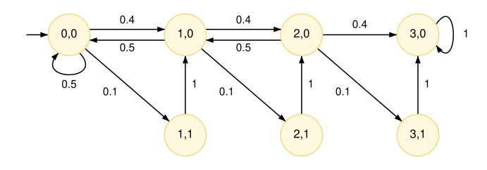

# Modules and commands

A PRISM model comprises one or more **modules**,
usually representing distinct system components that may interact with each other.
A module has two key ingredients:
**variables**, whose values define the state of the module,
and **commands**, which describe how the state of the module evolves over time.

## An example DTMC

The following simple example illustrates these basic concepts
on a PRISM model that defines a **discrete-time Markov chain** (DTMC).

[walk.prism](../files/walk.prism "include")

The model's type (discrete-time Markov chain) is denoted by the initial `dtmc` keyword.
It contains one module `M` whose state is defined by two integer-valued variables `x` and `y`,
with ranges `[0..3]` and `[0..1]`, respectively.
It models a variant of a one-sided, one-dimensional random walk:
it repeatedly randomly increments or decrements the value of `x` by one, until `x` reaches value `3`.
This only happens when variable `y` equals `0`.
On each increment of `x`, there is a chance that the value of `y` is flipped to `1`.
It will then be reset to `0` one step later.

The resulting Markov chain, whose states take the form `(x,y)`, is shown below.



<a id="commands"></a>
## Commands

A module's definition includes its [variables](Variables.md), discussed in more detail later, and its commands.
Each command comprises a **guard** and a probabilistic **update**.
The basic form is:

```prism
[action] guard -> prob_1 : update_1 + ... + prob_n : update_n;
```

The guard is a predicate over all the variables in the model,
indicating when the command is enabled.
Each individual update `update_i` describes a possible outcome of the command being executed,
defined by giving the new values of the module's variables,
with `x'=...` denoting the new value of variable `x`.
For a Markov chain, as above, each update `update_i` is assigned a probability `prob_i`,
and the probabilities in the command must sum to one.

Commands have an optional **action**, between the initial pair of square brackets.
These have multiple uses, including labelling [nondeterministic](ActionsAndNondeterminism.md) choices in MDPs
and [synchronisation](CompositionAndSynchronisation.md#synchronisation) between commands in different modules,
which are discussed in more detail later.
The current example omits actions.

A simple command looks like:

```prism
[] x=0 -> 0.8:(x'=1) + 0.2:(x'=2);
```

which, when variable `x` has value `0`, randomly updates it to either `1` or `2`, with probabilities `0.8` and `0.2`, respectively.

The right-hand side of an update can be an [expression](../Reference/PRISMLanguageSyntax.md#expressions)
in terms of the current values of the model's variables,
as in the first command of the `walk.prism` example above:

```prism
[] y=0 & x<3 -> 0.5:(x'=max(x-1,0)) + 0.4:(x'=x+1) + 0.1:(x'=x+1)&(y'=1);
```
where `(x'=x+1)` increments `x` by `1`
and `(x'=max(x-1,0))` decrements it by `1`, but ensures that it does not go below `0`.
Updates to multiple variables are concatenated with `&`, as in the last update above, which increments `x` and flips the value of `y` to `1`.
If a variable is not mentioned in an update, its value is assumed to remain unchanged,
i.e., `(x'=x+1)` above is equivalent to `(x'=x+1)&(y'=y)`.

Thanks to its guard, the command above is enabled whenever `y=0` and `x<3`.
It therefore defines the behaviour for three of the states in the Markov chain shown above:
`(0,0)`, `(1,0)` and `(2,0)`. For simple Markov chain models like the above,
we will usually assume that the guards are disjoint.
This will usually not be the case for models with [nondeterminism](ActionsAndNondeterminism.md)
or models with [synchronisation](CompositionAndSynchronisation.md#synchronisation) between modules.

If there are no enabled commands in some reachable state of the model,
this is referred to as a **deadlock** state.
PRISM's default behaviour is to add (probability 1) self-loops to such states and emit a warning.

## Updates

If a probability is omitted, it is assumed to be one:  

```prism
[] y=1 -> (y'=0);
```

and `true` is used to denote an empty update where no variable's value changes:

```prism
[] y=0 & x=3 -> true;
```
Changes to multiple variables in an update happen simultaneously.
So, for example, this command updates `y` to `0`, not `1`:

```prism
[] x=0 & y=0 -> (x'=1)&(y'=x);
```
